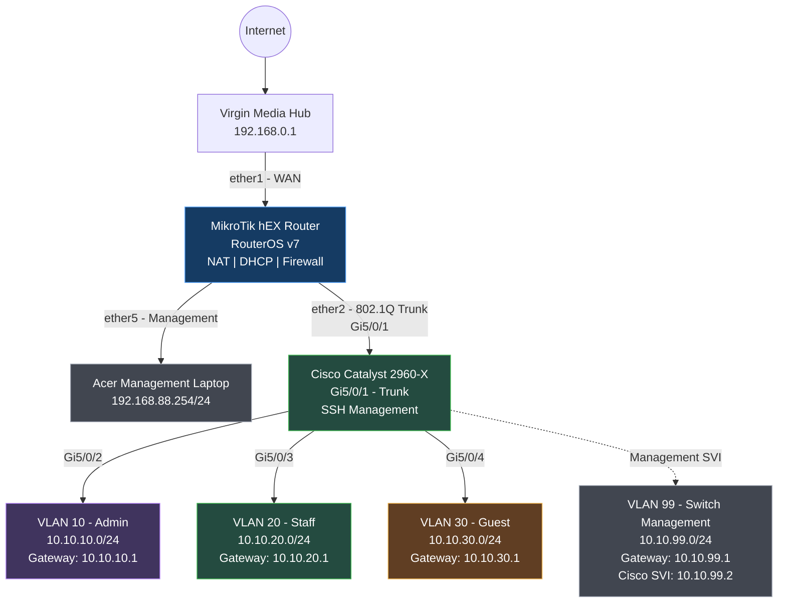

# Enterprise Home Network Lab — Network Topology

## Physical and Logical Network Diagram

## VLAN and IP Addressing

| VLAN | Purpose | Network | Gateway |
|---|---|---|---|
| 10 | Administration | 10.10.10.0/24 | 10.10.10.1 |
| 20 | Staff / Users | 10.10.20.0/24 | 10.10.20.1 |
| 30 | Guest Network | 10.10.30.0/24 | 10.10.30.1 |
| 99 | Switch Management | 10.10.99.0/24 | 10.10.99.1 |

## Network Infrastructure

**MikroTik hEX Router**
- WAN connection through ether1
- VLAN trunk through ether2
- Management access through ether5
- Inter-VLAN routing and firewall filtering
- DHCP, DNS and NAT
- Network monitoring using Netwatch

**Cisco Catalyst 2960-X**
- Gi5/0/1: 802.1Q trunk
- Gi5/0/2: Administration VLAN 10
- Gi5/0/3: Staff VLAN 20
- Gi5/0/4: Guest VLAN 30
- VLAN 99 SVI: 10.10.99.2
- SSH management with access restrictions
- Unused interfaces administratively disabled

## Security Implementation

- Guest network isolated from staff and management
- Guest access to the upstream home LAN blocked
- SSH and WinBox management restricted to authorised networks
- Cisco switch port security enabled
- Unused switch ports disabled
- Firewall rules tested using connectivity checks and rule counters

## Monitoring and Backup

- MikroTik Netwatch monitors the Cisco switch and internet connectivity
- Router configuration backed up locally
- Cisco running configuration saved to startup configuration
- Private configuration backups are excluded from public GitHub uploads
